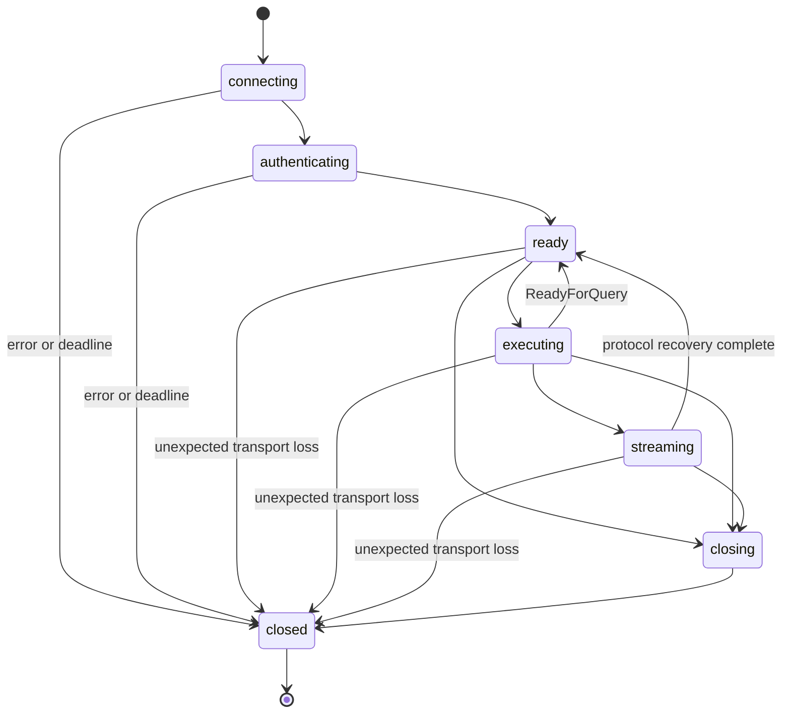

# Architecture

## Module boundaries

One npm package. Node net/tls/crypto/stream provide transport, authentication primitives, and stream
integration. The only direct runtime dependency is `@mongodb-js/saslprep` for the Unicode 3.2
normalization/prohibition/bidirectional tables used by PostgreSQL SCRAM. Write the small protocol core in TypeScript;
do not embed pg, fork Postgres.js, or publish separate internal packages.

| Module                   | Owns                                                               | Must not own                                            |
| ------------------------ | ------------------------------------------------------------------ | ------------------------------------------------------- |
| `config/`                | URI parsing, precedence, validation, safe credential access        | sockets or global mutable options                       |
| `protocol/`              | framing, encoders, discriminated backend messages                  | SQL building, retries, JS type policy                   |
| `auth/`                  | SCRAM/MD5/password exchanges, proof and channel-binding validation | pooling or reconnect supervision                        |
| `transport/`             | socket/TLS lifecycle, backpressure, cancellation transport         | request-to-result ownership                             |
| `codecs/`                | text/binary conversions, immutable registry, typed parameters      | catalog fetching or network I/O                         |
| `connection/`            | physical session, operation queue, protocol state, metadata        | automatic session resurrection                          |
| `session/`               | expiring capabilities, preparation, transaction/savepoint scopes   | replacing physical connections                          |
| `pool/`                  | FIFO acquisition, capacity, leases, retirement and close           | SQL rewriting or write retries                          |
| `streams/`               | portal batches, COPY lifecycle and producer/consumer backpressure  | bypassing the connection scheduler                      |
| `listener/`              | dedicated LISTEN connection, registrations, optional supervision   | sharing a query pool connection                         |
| `errors.ts`, `events.ts` | public diagnostics and safe observation                            | automatic logging of SQL/values                         |
| `index.ts`               | intentional public exports                                         | accidental exports of internal socket/message machinery |

Layer communication is ordinary functions, discriminated unions and small responsibility-specific
interfaces. Avoid a plugin framework, generic event bus, dependency injection container, or public
raw-protocol escape hatch. Add an internal adapter only where a real boundary benefits testing.

M2 implements config, protocol, auth, transport, codecs and connection modules. Transport owns socket/TLS
lifetime; the connection owns authentication and protocol/request state. M3 can reuse that transport
boundary for its separate cancellation connection. The codec module owns value conversion; `connection/query.ts` builds frontend operations.
Remaining module rows describe planned responsibility boundaries, not empty scaffolds.

## Physical connection state

There is deliberately no `closed -> connecting` edge. Reconnection creates a new object, new local
session ID, new backend identity, and new capability generation. Protocol transaction state (I/T/E)
is a separate field updated by every ReadyForQuery. Session status is not inferred from SQL strings.

A capability has `active -> expiring -> expired` state and a captured owner/generation. Expiring
fences new calls synchronously before asynchronous cleanup. A physical connection becoming closed
expires all child handles immediately. A pool lease generation changes on every checkout, even when
the same physical socket is retained. Prepared/transaction handles capture the lease generation.

## Operation ownership and dispatch

Each accepted operation records its owner/generation, local ID, deadline, encoded request buffers,
phase (`queued`, `sent`, `recovering`, `settled`), resolver/rejector, expected response state, and
completion evidence. Store no secret values in enumerable error/event properties.

1. Validate input and owner; reject already aborted or expired calls.
2. Reserve a bounded FIFO slot before calling user encoders, since an encoder may reenter the
   connection. Encoding is an unsent operation phase, not an independent scheduler.
3. Resolve parameter encoders and serialize the complete operation before writing its first byte.
   A failure settles only this operation as not-sent and releases its slot. Recheck the deadline
   after synchronous encoding, which may have prevented timer callbacks from running.
4. Write complete framed buffers with socket backpressure. A partial write failure destroys the
   connection; it cannot safely retry or reclaim the request as not-sent.
5. Route backend messages only to the active operation. Notices, parameter status, notifications and
   fatal errors are handled independently at any permitted point.
6. Capture command/error evidence, drain to ReadyForQuery, update transaction state, then settle and
   release the slot. A decoder exception cannot stop reading the recovery messages.

Use this one settlement path for query, description, preparation and future operation variants.
It owns timer disposal, abort-listener removal, queue release and exactly-once promise completion;
metadata delivery cannot bypass it. Child-process tests verify that completed Describe operations
leave no referenced timer or socket, including when server errors, aborts or deadlines occur.

Frame decoding handles all header/payload split points and multiple frames per TCP chunk. Validate
lengths before allocation, bound frames, preserve NULL distinct from empty bytes, reject invalid
counts and offsets, and bound NUL-string scans to the current frame. Unsupported or malformed
messages close the connection with a protocol error. Decoder byte views are internal and cannot
outlive recycled backing memory; public byte values are stable copies initially.

Protocol 3.0 is explicit. The codec understands raw field bytes and format codes even though ordinary
results request text initially. This avoids pg-protocol's current string-only DataRow constraint.
No dependency on another driver's unexported connection API is introduced.

## Query, description, preparation and scripts

Ordinary execution: Parse(unnamed), Bind(unnamed portal), Describe(portal), Execute, Sync. Values and
OID hints are known before send; do not add a preliminary Describe network round trip. Parse infers
unknown parameter OIDs. The protocol rejects multiple statements in Parse.

Description: Parse(unnamed), Describe(statement), Sync. Collect ParameterDescription and
RowDescription/NoData, then await ReadyForQuery. No Bind/Execute is sent. Named preparation follows
the same description cycle using a driver-generated name; explicit close sends Close(statement),
Sync. Each preparation handle stores field/OID metadata, never permanently cached parser functions.
Codecs belong to the immutable connection configuration. Dispose all lease-owned preparations before
returning its connection; failed disposal discards it. External SQL that deallocates statements is
caller-owned and invalidates those handles on the subsequent server error.

Named statement records distinguish submitting, confirmed, closing and expired states. Publish a
usable handle only after its creation operation succeeds. An encode error during reuse is a local
operation failure, not a reason to close or delete the previously confirmed statement. If creation
parses successfully but later description fails, close the unpublished statement during recovery
or discard the connection when that cleanup cannot be confirmed.

Built-in array metadata maps array OIDs to element OIDs and delimiters. The immutable codec registry
derives default array decoders from the selected scalar decoder, so scalar overrides apply without
capturing a stale default parser. Explicit array-OID overrides take precedence. Handle SQL NULL before
element decoding. JSON-bound descriptions distinguish a JSON-null token from typed SQL NULL; they
share ordinary parameter preflight and never inject SQL expressions. Raw JSON text codecs preserve
server text without JSON.parse.

The buffered byte budget charges complete row, field/parameter-description, command and empty-query
frames across the entire operation. Metadata-only description and scripts with many zero-row
commands therefore remain bounded. This is a wire-byte budget, not an exact heap measurement.

Scripts use Query(text), collect all successful result sets in order, then ReadyForQuery. On an error
reject the script, preserving the DatabaseError and prior command evidence; never silently return
partial success. This does not imply preceding effects were rolled back. Detailed partial results
are deferred as a public API until a concrete need, so 0.1 preserves command evidence internally and
does not promise a new public error property.

## Pool and release

The pool maintains connecting, idle, leased, and retiring sets plus a bounded FIFO waiter queue.
Connecting and retiring sockets count against the physical limit until fully disposed. Canceled
waiters are removed without consuming future capacity. A late connection goes to another valid
waiter or idle capacity; after close it is destroyed, never published. Timers are removed when their
owner settles. Idle timers may be unref'ed so an unused pool does not keep Node running.

Release expires the lease, finishes accepted work, disposes prepared handles, checks idle protocol
state, and either returns or destroys the connection. It does not reset arbitrary SQL session state.
withSession discards on callback failure rather than guessing whether session cleanup succeeded.
Active-session errors are delivered to their operations/callback capability, while idle disconnects
remove capacity and emit an observation event. Neither path requires the application to attach a
Node EventEmitter `error` listener to avoid process termination.

All externally visible operations, including acquisition and release, settle once. An unavailable
database must not leave reserved requests orphaned. Capacity accounting and waiter completion are
owned by the pool; socket callbacks cannot mutate them without going through the pool's state change.

## Transactions and child scopes

Only idle sessions enter managed transactions. BEGIN options come from enumerated values. A
transaction callback receives an expiring capability; it does not receive the pool, release, or
transport. Callback completion fences further calls before cleanup, waits for accepted operations,
and validates the server state before COMMIT. A server ROLLBACK tag is never reported as commit.

Savepoint scopes reserve exclusive ownership of the transaction queue for their entire callback and
cleanup. Work through a parent or sibling scope while a child is active rejects immediately. Child
failure runs ROLLBACK TO and RELEASE, bounded by cleanup timeout. Successful recovery leaves the
parent usable; failed recovery poisons it. SQL errors recovered by explicit manual savepoints do not
poison it merely because an earlier promise rejected. Expired capabilities reject before queueing.

No wrapper can stop user JavaScript or undo external side effects. On abort or connection loss,
expire the handle immediately, observe the still-running callback promise, and bound protocol
cleanup. A lost COMMIT acknowledgement is a distinct unknown-outcome error. If work and cleanup
both fail, preserve both in ordered AggregateError; do not hide the original failure.

## Cancellation and close

Cancellation before send removes only the queued operation. Once sent, the request's recorded
backend key is used on a separate bounded transport. Keep that key private. Record an interrupt
intent separately from evidence of server completion. A canceled connection retires regardless of
whether the original query finishes before the cancellation arrives, preventing late cancellation
from affecting a subsequent lease. Waiting unsent operations reject; already sent operations retain
individual confirmed/unknown evidence.

Close sets a permanent closing fence before doing asynchronous work. Stop waiter acceptance, idle
timers and listener retries; drain allowed work until its fixed deadline; destroy remaining sockets;
dispose resources and settle every waiter/request. A late password, DNS, TLS or socket completion
checks the fence before publishing resources. Use remaining absolute deadlines instead of restarting
timeouts at every stage. Client-side disposal is distinct from remote backend termination.

Pool close attempts cleanup of every owned connection/attempt even if one disposer fails. Collect
cleanup errors after all attempts instead of allowing the first rejection to abandon other resources.
Unfinished establishment belongs to the pool from its creation, not from its checkout event.

## Streaming, COPY, and listeners

Portal streaming owns an exclusive execution slot and performs bounded Execute/Flush batches. Close
sends Close(portal) and Sync, then drains before permitting another operation. A transport failure
invalidates the whole stream and its metadata/completion promises. An abandoned stream fails managed
callback success; it is not silently left alive after lease release.

COPY uses separate connection substates. Input respects source/socket backpressure; source errors
send CopyFail and recover to ReadyForQuery. Output buffers only to the stream high-water mark; early
exit cancels and retires the connection. No CSV or binary-record interpretation occurs in transport.

A listener supervisor owns immutable channel registrations and a replaceable physical connection.
Its public handle survives reconnect only when explicitly configured, but each connection generation
is observable. Re-register channels after authentication, then report connected. A permanent closed
fence disposes pending transports and backoff timers. Notifications during gaps are not replayable.

## Pipelining after the sequential core

Pipelining is opt-in and initially exposed only on exclusive sessions, with its exact option shape
decided at the performance milestone. Pool one-off queries remain exclusive. Do not add a no-op
configuration flag to the initial contract.

Encode each request before adding it to a sent queue; assign one Sync/error boundary per independent
operation and track ReadyForQuery for that boundary. Never combine independent operations into an
implicit shared transaction just to save Sync messages. Keep managed transactions, streaming, COPY,
description and preparation sequential/exclusive until each combination has a demonstrated need and
specific recovery tests. Pipelining cannot execute two queries simultaneously on a single backend.

## Evidence and tests

Use byte-level protocol tests, scripted fake-server scenarios, real PostgreSQL integration tests,
and an optional network fault proxy. Prefer controlled barriers (observed backend IDs, protocol
messages, server locks) over sleeps. Test user-visible results and resource ownership, not private
method names or documentation wording. Track accepted/settled operation counts and live resources
in test-only harnesses. Verify packed-package declarations and exports before publishing.

Add small, repeatable seeded operation sequences as pooling and preparation arrive. Check result
ownership, permanent lease expiration, complete settlement and irreversible close across generated
interleavings; log the seed and sequence on failure. Keep this in the existing Node test harness
until a demonstrated need warrants a fuzzing dependency. The
[Tenon report](references/tenon-driver-migration-report.md) supplies concrete regression seeds.
